  

# Awesome Agentic DevOps

A curated list of **Agentic DevOps** resources — the shift from deterministic, script-driven DevOps to autonomous AI agents that reason, act on infrastructure, self-correct, and collaborate with humans across the software delivery lifecycle.

Curated from six seed sources, then extended with independent web, GitHub, and YouTube research. **Every GitHub link was verified against the live API on 2026-10-17** (archived/moved repos were caught and handled — see the ⚠️ notes). Star counts are ⭐ as of that date.

**🌐 Web directory:** [awesome-agentic-devops.vercel.app](https://awesome-agentic-devops.vercel.app) — this list as a searchable, filterable single-page site.

**Sources:** [agenticdevops.fm](https://agenticdevops.fm) · [Opsera: What is Agentic DevOps?](https://opsera.ai/blog/what-is-agentic-devops) · [agenticsorg/devops](https://github.com/agenticsorg/devops) · [super-agentic.ai](https://super-agentic.ai/agentic-devops) · [DevOpsAIguru123/awesome-agentic-devops](https://github.com/DevOpsAIguru123/awesome-agentic-devops) · [agenticdevops/awesome-devops-mcp](https://github.com/agenticdevops/awesome-devops-mcp) — plus DORA, Microsoft/GitHub, Harness, StackOne, and the open-source SRE-agent ecosystem.

## Contents

- [What is Agentic DevOps?](#what-is-agentic-devops)
- [Concepts & Mental Models](#concepts--mental-models)
- [Protocols: MCP, A2A, AG-UI](#protocols-mcp-a2a-ag-ui)
- [Open-Source SRE & AIOps Agents](#open-source-sre--aiops-agents)
- [Coding Agents & Agentic CI/CD](#coding-agents--agentic-cicd)
- [Agent Frameworks & Toolkits](#agent-frameworks--toolkits)
- [MCP: Cloud & Infrastructure](#mcp-cloud--infrastructure)
- [MCP: Kubernetes & Containers](#mcp-kubernetes--containers)
- [MCP: Observability & Incident Response](#mcp-observability--incident-response)
- [MCP: CI/CD & Version Control](#mcp-cicd--version-control)
- [MCP: Security & Agent Safety](#mcp-security--agent-safety)
- [MCP: Data Platform & FinOps](#mcp-data-platform--finops)
- [Agent Skills Ecosystems](#agent-skills-ecosystems)
- [Platforms & Products](#platforms--products)
- [Podcasts, Talks & Video](#podcasts-talks--video)
- [Articles & Reports](#articles--reports)
- [Communities](#communities)
- [Safety First](#safety-first)
- [Related Awesome Lists](#related-awesome-lists)
- [Contributing](#contributing)

---

## What is Agentic DevOps?

A synthesis of the definitions this list is built on:

> **Microsoft (Build 2025):** AI-powered agents operating as members of dev and ops teams — Copilot agents plus Azure automating, optimizing, and accelerating the entire software lifecycle. [Azure blog](https://azure.microsoft.com/en-us/blog/agentic-devops-evolving-software-development-with-github-copilot-and-microsoft-azure) · [Azure solution page](https://azure.microsoft.com/en-us/solutions/devops)

> **Opsera:** The shift from static, human-managed scripts to autonomous agents that reason, self-correct, and manage the delivery pipeline — "autonomous decisioning across the software delivery lifecycle," not just autonomous execution. Combined with an AI-assisted upstream this becomes the **AIDLC** (AI Development Life Cycle). [Opsera](https://opsera.ai/blog/what-is-agentic-devops)

> **Superagentic AI:** A framework extending DevOps with autonomous agents capable of reasoning, decision-making, and adaptation — four pillars: automation→autonomy, intelligent orchestration, continuous learning, human-agent collaboration. [super-agentic.ai](https://super-agentic.ai/agentic-devops)

> **What it is NOT** (per Opsera): not traditional CI/CD automation (deterministic vs. probabilistic), not just LLM code generation (no agency), and not AIOps (AIOps surfaces anomalies; agentic DevOps reasons through causes and executes remediation).

## Concepts & Mental Models

- [Agentic DevOps — Microsoft Build 2025 announcement](https://azure.microsoft.com/en-us/blog/agentic-devops-evolving-software-development-with-github-copilot-and-microsoft-azure) — the canonical launch framing of the term.
- [Agentic DevOps in action: reimagining every phase of the developer lifecycle](https://developer.microsoft.com/blog/reimagining-every-phase-of-the-developer-lifecycle) — Microsoft Developer Blog, May 2025.
- [What is Agentic DevOps? — Opsera](https://opsera.ai/blog/what-is-agentic-devops) — three pillars (contextual reasoning, autonomous course-correction, dynamic tool orchestration) + human-in-the-loop; the AIDLC model; the PR-review bottleneck (AI code cuts PR-open time 58%, PRs sit 4.6× longer in review).
- [Agentic AI in DevOps: The Architect's Guide to Autonomous Infrastructure — Harness](https://www.harness.io/blog/agentic-ai-in-devops-the-architects-guide-to-autonomous-infrastructure) — the **C-P-A agent anatomy** (Context/Perception → Memory via RAG → Reasoning via ReAct → Tool use), three adoption horizons (Augmented Operator → Agent Swarms → Autonomous SRE), and guardrails for probabilistic ops (policy-as-code, contextual permissions, black-box recorder).
- [Agentic DevOps — Superagentic AI](https://super-agentic.ai/agentic-devops) — theoretical framework: four pillars, agent taxonomies (Development/QA/SRE/Optimization agents), traditional-vs-agentic comparison.
- [What are Agentic Workflows? — IBM](https://www.ibm.com/think/topics/agentic-workflows) — agentic workflows vs. static pipelines.
- [Agentic DevOps in Autonomous Cloud — GSDC](https://www.gsdcouncil.org/blogs/agentic-devops-autonomous-cloud-app-modernization) — observe → reason → plan → act loop for cloud ops.
- [The Agentic DevOps mental model — Microsoft Build 2026 BRK202](https://github.com/microsoft/Build26-BRK202-azure-devops-meets-github-the-path-to-ai-powered-sdlc) ⚠️ *session repo (archived after the event)*: hybrid GitHub + Azure Boards/Pipelines patterns for an AI-powered SDLC.
- [Operationalize AI agents with OpenShift/Kubernetes — Red Hat](https://developers.redhat.com/articles/operationalize-ai-agents-on-openshift-with-kubernetes-primitives) — running AIOps agents on K8s primitives.

## Protocols: MCP, A2A, AG-UI

The interoperability layer that made agentic DevOps practical ([StackOne landscape framing](https://www.stackone.com/blog/ai-agent-tools-landscape-2026): "MCP is how agents use tools. A2A is how agents collaborate.")

- [Model Context Protocol](https://modelcontextprotocol.io/) — the open standard for agent↔tool integration (now under the Linux Foundation).
- [modelcontextprotocol/servers](https://github.com/modelcontextprotocol/servers) ⭐91.3k — official reference server implementations.
- [modelcontextprotocol/python-sdk](https://github.com/modelcontextprotocol/python-sdk) / [typescript-sdk](https://github.com/modelcontextprotocol/typescript-sdk) — official SDKs.
- [modelcontextprotocol/registry](https://github.com/modelcontextprotocol/registry) — community registry service for MCP servers.
- [Docker MCP Catalog & Toolkit](https://docs.docker.com/ai/mcp-catalog-and-toolkit/) — verified containerized MCP servers + gateway governance.
- [A2A (Agent2Agent protocol)](https://a2a-protocol.org/) · [a2aproject/A2A](https://github.com/a2aproject/A2A) ⭐26.2k — agent-to-agent interoperability, originally from Google, now Linux Foundation.
- [AG-UI](https://docs.ag-ui.com/) — agent-to-user interaction protocol.

## Open-Source SRE & AIOps Agents

The fastest-moving corner of agentic DevOps: agents that diagnose clusters, investigate incidents, and remediate.

- [k8sgpt-ai/k8sgpt](https://github.com/k8sgpt-ai/k8sgpt) ⭐8.3k — "Giving Kubernetes Superpowers to everyone"; the original K8s SRE-diagnosis agent.
- [HolmesGPT/holmesgpt](https://github.com/HolmesGPT/holmesgpt) ⭐3.6k — CNCF Sandbox SRE agent for investigating production incidents and root causes across K8s, VMs, clouds, and databases (originated at Robusta).
- [keephq/keep](https://github.com/keephq/keep) ⭐12.4k — open-source AIOps and alert-management platform.
- [robusta-dev/robusta](https://github.com/robusta-dev/robusta) ⭐3.1k — smarter Prometheus alerts for Kubernetes: grouping, AI enrichment, automatic remediation.
- [kagent-dev/kagent](https://github.com/kagent-dev/kagent) ⭐4k — Cloud Native Agentic AI: run MCP tools and agents as Kubernetes CRDs (Solo.io).
- [Tracer-Cloud/opensre](https://github.com/Tracer-Cloud/opensre) ⭐12.1k — toolkit for building your own AI SRE agents.
- [kuafuai/DevOpsGPT](https://github.com/kuafuai/DevOpsGPT) ⭐6k — multi-agent system converting natural-language requirements into working DevOps workflows.
- [GoogleCloudPlatform/kubectl-ai](https://github.com/GoogleCloudPlatform/kubectl-ai) ⭐7.6k — AI-powered kubectl: conversational cluster operations.
- [VersusControl/versus-incident](https://github.com/VersusControl/versus-incident) ⭐863 — self-hosted AI SRE that learns normal system behavior and escalates anomalies.
- [Arvo-AI/aurora](https://github.com/Arvo-AI/aurora) ⭐436 — agentic incident management & root-cause analysis built on LangGraph.
- [mezmo/aura](https://github.com/mezmo/aura) ⭐398 — production-tested SRE agent platform with guardrails and APIs.
- [SREGym/SREGym](https://github.com/SREGym/SREGym) ⭐355 — benchmark environment: "Can AI agents resolve production incidents?"
- [netdata/netdata](https://github.com/netdata/netdata) ⭐81k — AI-powered full-stack observability with an assistant layer.
- [kubeshark/kubeshark](https://github.com/kubeshark/kubeshark) ⭐12.1k — eBPF network observability for K8s (the telemetry these agents feed on).
- [metalbear-co/mirrord](https://github.com/metalbear-co/mirrord) ⭐5.4k — run local processes (including coding agents) as if inside your K8s cluster — agent-friendly dev/prod bridging.
- [chaterm/Chaterm](https://github.com/chaterm/Chaterm) ⭐3.1k — open-source AI terminal for cloud/infrastructure management.

## Coding Agents & Agentic CI/CD

The "development agents" side of the lifecycle — and the workflow machinery that turns them into 24/7 repo operators.

- [GitHub Agentic Workflows (gh-aw)](https://github.github.com/gh-aw/) — agents as "a third pillar beside CI and CD": markdown-defined workflows compiled to hardened Actions YAML, sandboxed against the "lethal trifecta" (private data + untrusted content + outbound access), with per-run/daily AI-credit caps. Source: [github/gh-aw](https://github.com/github/gh-aw) ⭐5.4k · [Workflow gallery](https://github.github.com/gh-aw/gallery/) · [GitHub Next project page](https://githubnext.com/projects/agentic-workflows/) · [Security architecture](https://github.github.com/gh-aw/introduction/architecture/).
- [Repo Assist impact report](https://github.com/githubnext/repo-assist-impact) — measured results from running agentic workflows across 13 repos (578 issues closed, median 8× faster issue resolution).
- [anthropics/claude-code](https://github.com/anthropics/claude-code) ⭐151.7k — agentic terminal coding tool.
- [openai/codex](https://github.com/openai/codex) ⭐129.6k — lightweight terminal coding agent.
- [google-gemini/gemini-cli](https://github.com/google-gemini/gemini-cli) ⭐107.4k — open-source Gemini agent in the terminal.
- [OpenHands/OpenHands](https://github.com/OpenHands/OpenHands) ⭐91.1k — AI-driven autonomous development platform (formerly OpenDevin).
- [Aider-AI/aider](https://github.com/Aider-AI/aider) ⭐49.6k — AI pair programming in the terminal; git-native.
- [sweepai/sweep](https://github.com/sweepai/sweep) ⭐7.7k — AI junior dev turning issues into reviewed PRs (JetBrains).
- [github/awesome-copilot](https://github.com/github/awesome-copilot) ⭐40.1k — community instructions, agents, skills, and configs for GitHub Copilot.
- [dagger/dagger](https://github.com/dagger/dagger) ⭐16.3k — programmable CI/CD engine; its agent API powers agentic pipelines ([podcast E3 with Solomon Hykes](https://agenticdevops.fm/episodes/agentic-ci-cd-with-solomon-hykes-of-dagger)).
- [microsoft/apm](https://github.com/microsoft/apm) — Agent Project Manager: Microsoft's spec-driven agent workflow runner.
- [GitHub Next: Continuous AI](https://githubnext.com/projects/continuous-ai/) — research program behind self-improving repositories.

## Agent Frameworks & Toolkits

For building your own ops agents rather than adopting finished ones.

- [langchain-ai/langgraph](https://github.com/langchain-ai/langgraph) ⭐43.4k — graph-based agent orchestration.
- [crewAIInc/crewAI](https://github.com/crewAIInc/crewAI) ⭐59.8k — role-playing multi-agent orchestration.
- [openai/openai-agents-python](https://github.com/openai/openai-agents-python) ⭐30.1k — the Agents SDK (what powers agenticsorg/devops).
- [google/adk-python](https://github.com/google/adk-python) ⭐21.9k — Google Agent Development Kit.
- [GoogleCloudPlatform/agent-starter-pack](https://github.com/GoogleCloudPlatform/agent-starter-pack) — production agent templates with CI/CD, eval, observability.
- [anthropics/skills](https://github.com/anthropics/skills) ⭐181.8k — the Agent Skills standard and official repository.
- [Strands Agents](https://strandsagents.dev/) — AWS's open-source agent SDK (used in AWS's own CloudOps multi-agent samples).
- [aws-samples/sample-cloudops-multi-agent-platform](https://github.com/aws-samples/sample-cloudops-multi-agent-platform) — hierarchical multi-agent CloudOps reference on Bedrock AgentCore.

## MCP: Cloud & Infrastructure

Official-first MCP servers for cloud providers and IaC.

- [aws/agent-toolkit-for-aws](https://github.com/aws/agent-toolkit-for-aws) ⭐2.9k — the current official AWS MCP/skills/plugins toolkit (IAM-aware, CloudWatch/CloudTrail audit).
- [awslabs/mcp](https://github.com/awslabs/mcp) ⭐9.8k — the original AWS Labs MCP collection (being folded into Agent Toolkit).
- [microsoft/mcp](https://github.com/microsoft/mcp) ⭐3.8k — official catalog of Microsoft MCP implementations.
- [google/mcp](https://github.com/google/mcp) · [googleapis/gcloud-mcp](https://github.com/googleapis/gcloud-mcp) ⭐928 · [GoogleCloudPlatform/cloud-run-mcp](https://github.com/GoogleCloudPlatform/cloud-run-mcp) — official Google/GCP MCP surfaces.
- [cloudflare/mcp-server-cloudflare](https://github.com/cloudflare/mcp-server-cloudflare) — Workers, KV, R2, D1.
- [heroku/heroku-mcp-server](https://github.com/heroku/heroku-mcp-server) — full Heroku app lifecycle via CLI.
- [digitalocean-labs/mcp-digitalocean](https://github.com/digitalocean-labs/mcp-digitalocean) — droplets, App Platform, databases.
- [vercel/vercel-mcp-overview](https://github.com/vercel/vercel-mcp-overview) — hosted Vercel MCP for projects & deployments.
- [hashicorp/terraform-mcp-server](https://github.com/hashicorp/terraform-mcp-server) ⭐1.6k — Terraform Registry + HCP Terraform.
- [hashicorp/vault-mcp-server](https://github.com/hashicorp/vault-mcp-server) — Vault secrets management.
- [opentofu/opentofu-mcp-server](https://github.com/opentofu/opentofu-mcp-server) — OpenTofu Registry docs.
- [Pulumi MCP Server](https://www.pulumi.com/docs/ai/mcp-server/) — hosted Pulumi Cloud automation.
- ⚠️ [alexei-led/aws-mcp-server](https://github.com/alexei-led/aws-mcp-server) — **archived**; AWS CLI execution with pipes/templates in Docker. Historically influential community MCP.

## MCP: Kubernetes & Containers

- [containers/kubernetes-mcp-server](https://github.com/containers/kubernetes-mcp-server) ⭐2.2k — K8s + OpenShift operations with a read-only mode and production guide.
- [skyhook-io/radar](https://github.com/skyhook-io/radar) ⭐3.8k — open-source Kubernetes UI with built-in MCP server for AI-assisted operations.
- [kubernetes-sigs/mcp-lifecycle-operator](https://github.com/kubernetes-sigs/mcp-lifecycle-operator) — declarative deployment/rollout of MCP servers on K8s.
- [Flux159/mcp-server-kubernetes](https://github.com/Flux159/mcp-server-kubernetes) ⭐1.6k — TypeScript K8s operations (pods, deployments, services).
- [manusa/kubernetes-mcp-server](https://github.com/manusa/kubernetes-mcp-server) — CRUD for any K8s resource + OpenShift support.
- [rohitg00/kubectl-mcp-server](https://github.com/rohitg00/kubectl-mcp-server) — natural-language cluster interaction.
- ⚠️ [alexei-led/k8s-mcp-server](https://github.com/alexei-led/k8s-mcp-server) — **archived**; kubectl/helm/istioctl/argocd in a Docker sandbox.
- [weibaohui/kom](https://github.com/weibaohui/kom) & [weibaohui/k8m](https://github.com/weibaohui/k8m) — Go K8s SDK with built-in DevOps tools; multi-cluster management UI.
- [controlplaneio-fluxcd/flux-operator (MCP)](https://github.com/controlplaneio-fluxcd/flux-operator/tree/main/cmd/mcp) ⭐774 — Flux MCP from CNCF maintainers: drift detection, RCA, multi-cluster compare, impersonation, read-only mode.
- [ckreiling/mcp-server-docker](https://github.com/ckreiling/mcp-server-docker) — Docker containers/images/volumes/networks.
- [manusa/podman-mcp-server](https://github.com/manusa/podman-mcp-server) — Podman, pods included.
- [docker/hub-mcp](https://github.com/docker/hub-mcp) & [docker/mcp-registry](https://github.com/docker/mcp-registry) — Docker Hub workflows; verified MCP registry/catalog.

## MCP: Observability & Incident Response

- [grafana/mcp-grafana](https://github.com/grafana/mcp-grafana) ⭐3.6k — dashboards, incidents, datasources, and Prometheus/Alertmanager.
- [getsentry/toolkit](https://github.com/getsentry/toolkit) ⭐931 — home of Sentry's MCP (error tracking for human-in-the-loop debugging agents; formerly `sentry-mcp`).
- [datadog-labs/mcp-server](https://github.com/datadog-labs/mcp-server) + [Datadog MCP setup docs](https://docs.datadoghq.com/mcp_server/setup/) — Datadog observability for agents.
- [Honeycomb MCP](https://docs.honeycomb.io/integrations/mcp/) — traces, metrics, logs, SLOs, triggers via OAuth 2.1/scoped keys.
- [Elastic Agent Builder MCP](https://www.elastic.co/docs/explore-analyze/ai-features/agent-builder/mcp-server) — build observability agents on the Elastic stack.
- [Splunk MCP Server (Splunkbase)](https://splunkbase.splunk.com/app/7931) — official Splunk-platform MCP app.
- [newrelic/mcp-server](https://github.com/newrelic/mcp-server) — APM, dashboards, NRQL.
- [last9/last9-mcp-server](https://github.com/last9/last9-mcp-server) — pull production logs/metrics/traces into local agent contexts.
- [pydantic/logfire-mcp](https://github.com/pydantic/logfire-mcp) — OpenTelemetry-native observability.
- [Comet-ML/opik-mcp](https://github.com/comet-ml/opik-mcp) — LLM observability and traces.
- [pab1it0/prometheus-mcp-server](https://github.com/pab1it0/prometheus-mcp-server) — query and analyze Prometheus.
- ⚠️ [dynatrace-oss/dynatrace-mcp](https://github.com/dynatrace-oss/dynatrace-mcp) — **archived 2026**; still referenced widely but no longer maintained.
- ⚠️ [PagerDuty/pagerduty-mcp-server](https://github.com/PagerDuty/pagerduty-mcp-server) — **archived**; PagerDuty's incident MCP has moved to product-managed surfaces.

## MCP: CI/CD & Version Control

- [github/github-mcp-server](https://github.com/github/github-mcp-server) ⭐33.7k — GitHub's official MCP (repos, issues, PRs, Actions).
- [GitLab MCP server](https://docs.gitlab.com/user/gitlab_duo/model_context_protocol/mcp_server/) — GitLab-hosted MCP endpoint.
- [atlassian/atlassian-mcp-server](https://github.com/atlassian/atlassian-mcp-server) — official Rovo MCP: Jira, Confluence, JSM, Bitbucket, Compass.
- [Linear MCP](https://linear.app/docs/mcp) — hosted MCP with OAuth 2.1 dynamic registration and a read-only endpoint.
- [microsoft/azure-devops-mcp](https://github.com/microsoft/azure-devops-mcp) ⭐2.1k — official Azure DevOps MCP (repos, work items, pipelines).
- [jenkinsci/mcp-server-plugin](https://github.com/jenkinsci/mcp-server-plugin) — Jenkins as an MCP server.
- [argoproj-labs/mcp-for-argocd](https://github.com/argoproj-labs/mcp-for-argocd) ⭐588 — Argo CD GitOps MCP.
- [CircleCI-Public/mcp-server-circleci](https://github.com/CircleCI-Public/mcp-server-circleci) — build failure logs, flaky-test detection.
- [harness/mcp-server](https://github.com/harness/mcp-server) — CI/CD pipelines with a risk-tiered model that blocks destructive ops without confirmation.
- [Tiberriver256/mcp-server-azure-devops](https://github.com/Tiberriver256/mcp-server-azure-devops) ⭐394 — community Azure DevOps MCP.
- ⚠️ [ko1ynnky/github-actions-mcp-server](https://github.com/ko1ynnky/github-actions-mcp-server) — **archived**; GitHub Actions interaction.

## MCP: Security & Agent Safety

- [OWASP MCP Top 10](https://owasp.org/www-project-mcp-top-10/) — the risk framework for MCP-powered agentic pipelines.
- [snyk/agent-scan](https://github.com/snyk/agent-scan) ⭐3.1k — security scanner for AI agents, MCP servers, and agent skills.
- [snyk/studio-mcp](https://github.com/snyk/studio-mcp) + [Snyk Studio docs](https://docs.snyk.io/evo-by-snyk/agentic-security-with-snyk-studio/getting-started-with-snyk-studio) — SCA/code/IaC/container/SBOM/secret scans via `snyk mcp`.
- [SonarSource/sonarqube-mcp-server](https://github.com/SonarSource/sonarqube-mcp-server) ⭐665 — code quality & security insights.
- [cisco-ai-defense/mcp-scanner](https://github.com/cisco-ai-defense/mcp-scanner) ⭐1.1k — scan MCP servers with YARA rules + LLM-as-judge.
- [aquasecurity/trivy-mcp](https://github.com/aquasecurity/trivy-mcp) — Trivy vulnerability/misconfiguration/secret scanning via MCP.
- [CrowdStrike/falcon-mcp](https://github.com/CrowdStrike/falcon-mcp) — Falcon SOC automation (threat detection, NG-SIEM, CSPM).
- [okta/okta-mcp-server](https://github.com/okta/okta-mcp-server) — identity workflows for agents.
- [Wiz WIN MCP Server](https://docs.wiz.io/dev/win-mcp-server) — CNAPP/cloud security.
- [DopplerHQ/mcp-server](https://github.com/DopplerHQ/mcp-server) — secrets management (write-capable: scope service tokens).
- [BurtTheCoder/mcp-shodan](https://github.com/BurtTheCoder/mcp-shodan) & [mcp-virustotal](https://github.com/BurtTheCoder/mcp-virustotal) — OSINT/threat-intel lookups.
- [nono (nolabs)](https://github.com/nolabs-ai/nono) — agent sandboxing CLI for local agent workloads (featured on [Agentic DevOps E13](https://agenticdevops.fm/episodes/ai-agent-sandboxing-with-nono)).

## MCP: Data Platform & FinOps

- [googleapis/mcp-toolbox](https://github.com/googleapis/mcp-toolbox) ⭐16.7k — MCP Toolbox for Databases.
- [bytebase/dbhub](https://github.com/bytebase/dbhub) ⭐3.7k — universal SQL MCP (Postgres, MySQL, SQL Server, SQLite; read-only mode, row limits).
- [mongodb-js/mongodb-mcp-server](https://github.com/mongodb-js/mongodb-mcp-server) ⭐1.1k — MongoDB/Atlas.
- [redis/mcp-redis](https://github.com/redis/mcp-redis) — natural-language Redis management + vector search.
- [dbt-labs/dbt-mcp](https://github.com/dbt-labs/dbt-mcp) — dbt Core/Fusion/Platform context.
- [vantage-sh/vantage-mcp-server](https://github.com/vantage-sh/vantage-mcp-server) — FinOps: cloud spend, budgets, anomalies.
- [infracost/infracost](https://github.com/infracost/infracost) ⭐12.6k — cloud cost estimates in CLIs, CI/CD, and coding agents ("shift FinOps left").

## Agent Skills Ecosystems

Portable skill packs agents load on demand — the fastest-growing layer of 2026.

- [anthropics/skills](https://github.com/anthropics/skills) ⭐181.8k — the Agent Skills standard + official Anthropic pack.
- [google/skills](https://github.com/google/skills) · [microsoft/skills](https://github.com/microsoft/skills) · [microsoft/azure-skills](https://github.com/microsoft/azure-skills) · [microsoft/azure-devops-skills](https://github.com/microsoft/azure-devops-skills) — official vendor skill packs.
- [harness/harness-skills](https://github.com/harness/harness-skills) — natural-language CI/CD skills for Claude Code/Cursor/Copilot.
- [VoltAgent/awesome-agent-skills](https://github.com/VoltAgent/awesome-agent-skills) ⭐35.9k — 1,000+ skills from official teams and community.
- [BagelHole/DevOps-Security-Agent-Skills](https://github.com/BagelHole/DevOps-Security-Agent-Skills) ⭐1.2k — 80+ DevOps/security/infra/compliance skills.
- [addyosmani/agent-skills](https://github.com/addyosmani/agent-skills) — engineering skill reference (structure/style input).
- [antonbabenko/terraform-skill](https://github.com/antonbabenko/terraform-skill) — Terraform prompt/workflow skill.
- [DevOpsAIguru123 skill installer](https://github.com/DevOpsAIguru123/awesome-agentic-devops#install-skills-into-your-coding-agent) — one command installs 360+ official skills into Claude Code/Cursor/Codex/VS Code.

## Platforms & Products

- [Agentic DevOps (agenticsorg)](https://github.com/agenticsorg/devops) — open-source autonomous DevOps platform on the OpenAI Agents SDK (AWS + GitHub, live demo at [agentic-devops.fly.dev](https://agentic-devops.fly.dev)); `pip install agentic-devops`.
- [Opsera Agentic DevOps](https://opsera.ai/) — unified DevOps platform with agentic pipelines and compliance automation.
- [GitHub Copilot + Azure Agentic DevOps](https://azure.microsoft.com/en-us/solutions/devops) — Microsoft's productized agentic SDLC.
- [Harness AI DevOps Agent](https://www.harness.io/products/platform) — AI DevOps agent embedded in the Harness platform.
- [Anyshift](https://www.anyshift.io/) — always-on AI SRE that proactively finds risks (featured on [Agentic DevOps E10](https://agenticdevops.fm/episodes/ai-sres-chat-with-your-infrastructure-with-anyshift)).
- [Devopness](https://github.com/devopness/devopness) — AI DevOps on your cloud: one MCP, deterministic deployments.
- [CloudBees Agentic DevOps World](https://www.cloudbees.com/agentic-devops-world) — 2026 world roadshow on agentic DevOps.
- [10 Best AI Agents for Cloud Infrastructure 2026 — CloudGeni](https://blog.cloudgeni.ai/10-best-ai-agents-for-cloud-infrastructure-management-in-2026) — vendor comparison across IaC support, remediation, incident response.

## Podcasts, Talks & Video

**Podcast: [Agentic DevOps — AI Engineering for Infrastructure](https://agenticdevops.fm)** (Bret Fisher, since May 2025 — "real-world AI agents for DevOps without the hand-wavy hype"). Full extracted episode index:

| # | Episode | Guest | Date |
|---|---------|-------|------|
| E14 | [Rogue AI or Just Sloppy Ops?](https://agenticdevops.fm/episodes/rogue-ai-or-just-sloppy-ops) | — | 2026-09-25 |
| E13 | [AI Agent Sandboxing with Nono](https://agenticdevops.fm/episodes/ai-agent-sandboxing-with-nono) | Luke Hinds (nolabs) | 2026-08-21 |
| E12 | [AI-Native Engineering Culture from a CTO](https://agenticdevops.fm/episodes/ai-native-engineering-culture-from-a-cto) | Mike Rollins | 2026-08-01 |
| E11 | [Safer Agent Automation with GitHub Agentic Workflows](https://agenticdevops.fm/episodes/safer-agent-automation-with-github-agentic-workflows) | Don Syme (GitHub Next), Peli de Halleux (MSR) | 2026-06-17 |
| E10 | [AI SREs, Chat With Your Infrastructure with Anyshift](https://agenticdevops.fm/episodes/ai-sres-chat-with-your-infrastructure-with-anyshift) | Anyshift founders | 2026-05-06 |
| E9 | [Can AI Agents Safely Become DevOps Engineers?](https://agenticdevops.fm/episodes/can-ai-agents-safely-become-devops-engineers) | Sam Alba (Mendral) | 2026-04-29 |
| E8 | [Our Favorite Agent Setups](https://agenticdevops.fm/episodes/our-favorite-agent-setups) | Brian Christner | 2026-04-14 |
| E7 | [Four Months Felt Like Four Years](https://agenticdevops.fm/episodes/four-months-felt-like-four-years) | Bret & Nirmal | 2026-03-26 |
| E6 | [AI Hype vs. Reality — Real Stats](https://agenticdevops.fm/episodes/ai-hype-vs-reality-real-stats-from-laura-tacho-cto-of-dx) | Laura Tacho (DX) | 2025-09-25 |
| E5 | [My Favorite AI Terminal, Prompt Injection, and More](https://agenticdevops.fm/episodes/my-new-favorite-ai-terminal-prompt-injection-and-more) | — | 2025-08-01 |
| E4 | [AWS Agentic DevOps with the EKS MCP Server](https://agenticdevops.fm/episodes/aws-agentic-devops-with-the-eks-mcp-server) | Rajdeep Saha (AWS) | 2025-07-22 |
| E3 | [Agentic CI/CD with Solomon Hykes of Dagger](https://agenticdevops.fm/episodes/agentic-ci-cd-with-solomon-hykes-of-dagger) | Solomon Hykes | 2025-07-14 |
| E2 | [Running AI MCP Tools on Kubernetes with kagent](https://agenticdevops.fm/episodes/running-ai-mcp-tools-on-kubernetes-with-kagent) | Eitan Yarmush (Solo.io) | 2025-07-08 |
| E1 | [Is AI ready for DevOps?](https://agenticdevops.fm/episodes/is-ai-ready-for-devops) | Bret & Nirmal | 2025-06-03 |

**Video:**

- [Introducing GitHub Agentic Workflows: AI that runs your repo — Microsoft Research Forum](https://www.microsoft.com/en-us/research/video/introducing-github-agentic-workflows-ai-that-runs-your-repo/) (Peli de Halleux & Yash Lara, May 2026) — markdown-as-workflow-language, sandbox layers, "order and orchestration, not swarms and chaos."
- [Safer Agent Automation with GitHub Agentic Workflows — Bret Fisher (YouTube)](https://www.youtube.com/watch?v=zmM8VISTOwo) — video version of E11 with Don Syme & Peli de Halleux.
- [Agentic Workflows with Don Syme — Scott Hanselman (YouTube)](https://www.youtube.com/watch?v=647pVgfV2yU).
- [Agentic DevOps playlist — Bret Fisher (YouTube)](https://www.youtube.com/playlist?list=PLX0bTycx8m-XeTa1dAT_PIdzNYgUI45bZ) — all podcast episodes in video.
- [The future of software creation with Agentic DevOps — Microsoft Reactor](https://developer.microsoft.com/en-us/reactor/events/26634/) — recorded talk, Copilot + agents across the SDLC.
- [Microsoft's NEW AI Agentic DevOps — FiraX AI (YouTube)](https://www.youtube.com/watch?v=Pz-KqJHP5JE) — accessible overview of the Microsoft vision.

## Articles & Reports

- [DORA: State of AI-assisted Software Development 2025](https://dora.dev/dora-report-2025/) — AI as an **amplifier** of existing org strengths/weaknesses; unstable AI adoption correlates with *reduced* throughput and stability. ([Google Cloud announcement](https://cloud.google.com/blog/products/ai-machine-learning/announcing-the-2025-dora-report), [DORA gen-AI research](https://dora.dev/ai/gen-ai-report/), [insights](https://dora.dev/insights/))
- [Opsera 2026 Benchmark Report: AI coding impact](https://opsera.ai/resources/report/ai-coding-impact-2026-benchmark-report) — 90% of enterprise teams use AI in the SDLC; PR review time 4.6× longer; 21% of AI licenses underutilized.
- [StackOne: 120+ Agentic AI Tools Across 11 Categories](https://www.stackone.com/blog/ai-agent-tools-landscape-2026) — the broadest current landscape map (frameworks → protocols → enterprise platforms).
- [Harness: Agentic AI in DevOps — Architect's Guide](https://www.harness.io/blog/agentic-ai-in-devops-the-architects-guide-to-autonomous-infrastructure) — C-P-A anatomy, three horizons, guardrails.
- [Opsera: What is Agentic DevOps?](https://opsera.ai/blog/what-is-agentic-devops) — definition, pillars, AIDLC, adoption.
- [Superagentic AI: Agentic DevOps](https://super-agentic.ai/agentic-devops) — theoretical framework and agent taxonomies.
- [Microsoft: Agentic DevOps in action](https://developer.microsoft.com/blog/reimagining-every-phase-of-the-developer-lifecycle) — reimagining each SDLC phase with agents.
- [Red Hat: Operationalize AI agents on OpenShift](https://developers.redhat.com/articles/operationalize-ai-agents-on-openshift-with-kubernetes-primitives) — K8s primitives for manageable AIOps.

## Communities

- [Agentic DevOps Discord](https://discord.gg/ZSPktpB3eW) — from the awesome-devops-mcp maintainers.
- [DevOps Discord (Bret Fisher)](https://discord.gg/devops) — broader community behind the podcast.
- [kagent Discord](https://bit.ly/kagentdiscord) — cloud-native agentic AI community.
- [Bret's free GitHub security workshop (gasa)](https://bretfisher.com/gasa-workshop/) — hands-on repo/workflow hardening against supply-chain attacks.

## Safety First

Agentic DevOps agents can change infrastructure. Ground rules distilled from the sources above:

1. **Read-only or proposal mode first** — gh-aw's `staged: true`, read-only MCP modes (K8s, DBHub, Flux), and approval gates before any write.
2. **Beware the "lethal trifecta"** — private data + untrusted content (PRs, issues, web) + outbound access in one sandbox. GitHub's answer: six defense layers; yours should be at least one.
3. **Policy-as-code beats vibes** — deterministic checks (OPA, protected approvals) must gate probabilistic agents; block `terraform destroy`-class actions outright.
4. **Scope credentials per agent** — diagnosis agents get read-only; remediation agents get namespace-scoped writes; secrets via Doppler/Vault MCPs, never in prompts.
5. **Record everything** — black-box recorder / compliance evidence packets for every production-adjacent run (see the [OWASP MCP Top 10](https://owasp.org/www-project-mcp-top-10/) and [DevOpsAIguru123's safety model](https://github.com/DevOpsAIguru123/awesome-agentic-devops/blob/main/docs/safety-model.md)).

## Related Awesome Lists

- [DevOpsAIguru123/awesome-agentic-devops](https://github.com/DevOpsAIguru123/awesome-agentic-devops) — scored, official-first catalog with CI auditing and skill installer (80+ entries).
- [agenticdevops/awesome-devops-mcp](https://github.com/agenticdevops/awesome-devops-mcp) — MCP servers for DevOps practitioners.
- [rohitg00/awesome-devops-mcp-servers](https://github.com/rohitg00/awesome-devops-mcp-servers) ⭐1k — DevOps-focused MCP discovery list.
- [punkpeye/awesome-mcp-servers](https://github.com/punkpeye/awesome-mcp-servers) ⭐96.5k — the canonical all-domain MCP list.
- [punkpeye/awesome-mcp-clients](https://github.com/punkpeye/awesome-mcp-clients) — MCP-compatible clients.
- [e2b-dev/awesome-ai-agents](https://github.com/e2b-dev/awesome-ai-agents) ⭐30.5k — autonomous agent list.
- [github/awesome-copilot](https://github.com/github/awesome-copilot) ⭐40.1k — Copilot instructions/agents/skills.
- [hesreallyhim/awesome-claude-code](https://github.com/hesreallyhim/awesome-claude-code) ⭐55.9k — Claude Code resources.

## Contributing

PRs welcome. Requirements: (1) the link must be live and relevant to *agentic* DevOps — not generic AIOps or plain automation; (2) one-line operator-focused description; (3) note archived status if applicable. See [CONTRIBUTING.md](CONTRIBUTING.md).

## License

[MIT](LICENSE)
